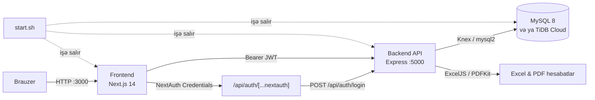

**[English](README.md)** | **Azərbaycanca**

# InsurApp — Sığorta İdarəetmə Sistemi

DEMO  - 
USERNAME - admin@insurance.az
PASSWORD  - password


Sığorta agentlikləri üçün tam işlək **sığorta polisləri, ödənişlər, komissiyalar, bonuslar və hesabatlar** idarəetmə sistemi. Layihə iki ayrı tətbiqdən ibarətdir: Express + MySQL backend və Next.js 14 frontend.

> **Kimə uyğundur:** sığorta şirkətləri, agentliklər və brokerlər — admin, agent və subagent rolları ilə çoxistifadəçili iş axını üçün.

---

## Əsas xüsusiyyətlər

### Rollar və giriş
- **Admin, agent və subagent** rolları üçün rol əsaslı giriş (NextAuth + JWT).
- Admin agent/subagent yaradır, redaktə edir, deaktiv edir; subagent valideyn agentə bağlanır.
- Agent profili: telefon, vəzifə, filial, FIN, şəhadətnamə (Ş-V), ünvan, şirkətlər və 0–5 ulduz reytinqi.
- Şifrə bərpası: istifadəçi sorğu göndərir → **admin təsdiqləyir** → 60 dəqiqə ərzində yeni şifrə təyin olunur.

### Sığorta polisləri
- 9 qrupda **54 sığorta məhsulu** (icbari, könüllü, Atəşgah, Atəşgah Həyat, Paşa, Paşa Həyat, Xalq, Meqa, Qala).
- 4 qiymət mühərriki kateqoriyası: **avtomobil (MTPL), kasko, əmlak, səfər**.
- Polis yaradılarkən mükafat avtomatik hesablanır, ödəniş və komissiya qeydləri eyni əməliyyatda yaradılır.
- Polis statusları: `active`, `upcoming`, `expired`, `terminated`, `cancelled`.
- Tarix aralığı filtrləri, məhsul üzrə filtr, detallı polis kartı.

### Ödənişlər və komissiyalar
- Hər polis üçün ödəniş qeydi: `pending`, `paid`, `overdue`; ödəniş üsulu və tarixi.
- Admin ödəniş statusunu dəyişir, ümumi ödəniş statistikasını görür.
- Agent komissiyası `mükafat × komissiya faizi` düsturu ilə hesablanır.

### Bonuslar və qiymət qaydaları
- Admin tərəfindən agent/subagentlərə **məhsul üzrə fərdi bonus** təyini (toplu təyinat dəstəyi).
- **Qiymət qaydaları**: şərtsiz və ya sahə/operator/dəyər şərtli əlavə faiz qaydaları, `effective_from` ilə qüvvəyə minmə tarixi.
- Bonus hesablama köməkçiləri: Atəşgah avto komissiya cədvəli, Paşa bonus cədvəli, region komissiyası.

### Hesabatlar
- Admin: ümumi göstəricilər, növ və məhsul üzrə bölgü, agent reytinqi, drill-down.
- Agent/subagent: yalnız öz satış hesabatı.
- **Excel (ExcelJS)** və **PDF (PDFKit)** ixracı; tarix filtrləri.
- Qrafiklər və vizuallaşdırma: Recharts.

### Ünsiyyət
- Admin bildirişləri (auditoriya: hamı / agent / subagent).
- Ümumi chat və **şəxsi yazışma (inbox)**; fayl və şəkil əlavələri (base64).

---

## Texnologiya yığını

| Qat | Texnologiyalar |
| --- | --- |
| **Frontend** | Next.js 14 (App Router), React 18, TypeScript, Tailwind CSS, Radix UI, shadcn-style komponentlər, TanStack Table, Recharts, React Hook Form + Zod |
| **Auth (frontend)** | NextAuth 4 (Credentials provider, JWT sessiyası) |
| **Backend** | Node.js, Express 4, Zod validasiyası, JWT, bcryptjs |
| **Verilənlər bazası** | MySQL 8.0+ (Knex query builder, `mysql2`), TiDB Cloud uyğun (TLS) |
| **İxrac** | ExcelJS, PDFKit |
| **Orkestrasiya** | `start.sh` — MySQL + backend + frontend |

---

## Arxitektura



**Axın:** İstifadəçi NextAuth ilə daxil olur → NextAuth backend-in `/api/auth/login` endpoint-inə müraciət edir → backend JWT qaytarır → token sessiyada saxlanılır → bütün API sorğuları `Authorization: Bearer <token>` başlığı ilə gedir.

---

## Layihə strukturu

```text
InsurApp/
├── start.sh                        # MySQL + backend + frontend-i birlikdə qaldırır
├── System-insurance-back-master/   # Express API
│   ├── migrations/                 # 001–016 SQL miqrasiyaları + runner
│   ├── src/
│   │   ├── app.js                  # Express tətbiqi, CORS, route-lar
│   │   ├── config/db.js            # Knex + MySQL/TiDB bağlantısı
│   │   ├── middleware/             # JWT autentifikasiya, rol yoxlaması
│   │   └── modules/
│   │       ├── auth/               # giriş, profil, agentlər, şifrə bərpası
│   │       ├── policies/           # polislər + qiymət mühərriki
│   │       ├── payments/           # ödənişlər
│   │       ├── reports/            # hesabatlar + Excel/PDF ixracı
│   │       ├── pricing-rules/      # bonus/qiymət qaydaları
│   │       ├── bonuses/            # fərdi bonuslar
│   │       └── board/              # bildirişlər + chat
│   ├── env.example
│   └── package.json
└── System-insurance-front-master/  # Next.js tətbiqi
    ├── src/app/
    │   ├── (auth)/login/           # giriş + şifrə bərpası
    │   └── (dashboard)/            # dashboard, policies, payments, reports,
    │                               # agents, bonuses, pricing-rules, ...
    ├── src/components/             # UI, sidebar, kalkulyatorlar, board
    ├── src/lib/                    # api klienti, auth konfiqurasiyası, kataloq
    ├── env.local.example
    └── package.json
```

---

## Sürətli başlanğıc

### Tələblər

- **Node.js 18.17+** (20 LTS tövsiyə olunur)
- **npm** (hər iki tətbiqdə `package-lock.json` var — `npm ci` və ya `npm install`)
- **MySQL 8.0+** və ya **TiDB Cloud** (TLS ilə)
- `start.sh` üçün Linux mühiti və `sudo` (MySQL-i avtomatik quraşdırır)

### 1. Reponu klonla

```bash
git clone https://github.com/Elsen001/InsurApp.git
cd InsurApp
```

### 2. Backend-i qur

```bash
cd System-insurance-back-master
cp env.example .env
# .env faylında DB_PASSWORD və JWT_SECRET dəyərlərini dəyişin
npm install
npm run migrate     # bütün SQL miqrasiyaları + seed data
npm run dev         # http://localhost:5000
```

Sağlamlıq yoxlaması: `curl http://localhost:5000/health`

### 3. Frontend-i qur

```bash
cd ../System-insurance-front-master
cp env.local.example .env.local
# NEXT_PUBLIC_API_URL yalnız origin olmalıdır: http://localhost:5000
npm install
npm run dev         # http://localhost:3000
```

> **Vacib:** `NEXT_PUBLIC_API_URL` dəyərinə `/api` yazmayın. API klienti özü hər sorğuya `/api/...` əlavə edir; `http://localhost:5000/api` yazsanız sorğular `/api/api/...` ünvanına gedəcək.

### 4. Hər şeyi bir əmrlə qaldır (Linux / Codespaces)

```bash
cp System-insurance-back-master/env.example System-insurance-back-master/.env
bash start.sh
```

`start.sh` nələr edir:

1. MySQL-i yoxlayır, yoxdursa `apt` ilə quraşdırır və `insurance_db` bazasını yaradır.
2. Frontend üçün `.env.local` faylını yazır (Codespaces-də public URL-lərlə).
3. Backend (`:5000`) və frontend (`:3000`) proseslərini `logs/` qovluğuna log yazaraq başladır.
4. Codespaces-də 3000 və 5000 portlarını public edir.

Loglar: `logs/mysql.log`, `logs/backend.log`, `logs/frontend.log`.

### Demo hesablar

Miqrasiyalar `002_seed_data.sql` ilə aşağıdakı hesabları yaradır:

| Rol | E-poçt | Şifrə |
| --- | --- | --- |
| Admin | `admin@insurance.az` | `password` |
| Agent | `ali.hasanov@insurance.az` | `password` |
| Agent | `nigar.aliyeva@insurance.az` | `password` |

> **Qeyd:** `002_seed_data.sql` başlığında `Admin123!` / `Agent123!` yazılsa da, fayldakı bcrypt hash `password` şifrəsinə aiddir və `start.sh` da `password` göstərir.

---

## Mühit dəyişənləri

### Backend (`System-insurance-back-master/.env`)

| Dəyişən | Tələb olunur | İzah |
| --- | --- | --- |
| `PORT` | Xeyr | API portu (default `5000`) |
| `DB_HOST` | Bəli | MySQL/TiDB hostu |
| `DB_PORT` | Xeyr | Default `3306` (TiDB: `4000`) |
| `DB_USER` | Bəli | Baza istifadəçisi |
| `DB_PASSWORD` | Bəli | Baza şifrəsi |
| `DB_NAME` | Xeyr | Default `insurance_db` |
| `DB_SSL` | Xeyr | Uzaq baza üçün `true` |
| `DB_CA` | Xeyr | CA faylının yolu (boş buraxılsa sistem CA-ları) |
| `JWT_SECRET` | Bəli | JWT imzalama açarı — produksiyada mütləq dəyişin |
| `JWT_EXPIRES_IN` | Xeyr | Default `7d` |
| `NODE_ENV` | Xeyr | `development` / `production` |
| `FRONTEND_URL` | Xeyr | CORS üçün frontend origin-i |

### Frontend (`System-insurance-front-master/.env.local`)

| Dəyişən | Tələb olunur | İzah |
| --- | --- | --- |
| `NEXT_PUBLIC_API_URL` | Bəli | Backend origin-i, **`/api` olmadan** (məs. `http://localhost:5000`) |
| `NEXTAUTH_URL` | Bəli | Frontend-in tam ünvanı (məs. `http://localhost:3000`) |
| `NEXTAUTH_SECRET` | Bəli | Sessiya şifrələmə açarı — produksiyada dəyişin |

---

## API icmalı

Bütün endpoint-lər `http://localhost:5000` üzərindədir. Qorunan route-lar `Authorization: Bearer <JWT>` tələb edir.

### Auth — `/api/auth`

| Metod | Yol | İcazə | Təsvir |
| --- | --- | --- | --- |
| `POST` | `/login` | Açıq | Giriş, JWT + istifadəçi məlumatı |
| `POST` | `/logout` | Auth | Çıxış |
| `GET` | `/me` | Auth | Cari istifadəçi profili |
| `POST` | `/password-reset/request` | Açıq | Şifrə bərpası sorğusu |
| `POST` | `/password-reset/complete` | Açıq | Təsdiqdən sonra yeni şifrə |
| `GET` | `/password-reset/requests` | Admin | Gözləyən sorğular |
| `PUT` | `/password-reset/:id` | Admin | Təsdiq / imtina |
| `GET` | `/agents` | Admin | Agentlər + subagentlər |
| `GET` | `/staff` | Admin | Bonus təyini üçün düz siyahı |
| `POST` | `/agents` | Admin | Agent/subagent yarat |
| `PUT` | `/agents/:id` | Admin | Profil, komissiya, status, şifrə |

### Polislər — `/api/policies`

| Metod | Yol | İcazə | Təsvir |
| --- | --- | --- | --- |
| `GET` | `/` | Auth | Agent özününküləri, admin hamısını görür |
| `GET` | `/:id` | Auth | Polis + detallar + ödəniş + komissiya |
| `POST` | `/` | Auth | Polis yarat (qiymət avtomatik) |
| `POST` | `/preview-price` | Auth | Qiyməti öncədən hesabla |
| `PUT` | `/:id` | Admin | Status, qeyd, əlaqə məlumatları |
| `DELETE` | `/:id` | Admin | Ləğv et (soft delete → `cancelled`) |

### Ödənişlər — `/api/payments`

| Metod | Yol | İcazə | Təsvir |
| --- | --- | --- | --- |
| `GET` | `/` | Auth | Ödənişlər (agent yalnız özününküləri) |
| `GET` | `/stats` | Admin | Statuslar üzrə statistika |
| `PUT` | `/:id/status` | Admin | Status və ödəniş üsulu |

### Hesabatlar — `/api/reports`

| Metod | Yol | İcazə | Təsvir |
| --- | --- | --- | --- |
| `GET` | `/my` | Auth | Öz hesabatı |
| `GET` | `/my/export` | Auth | Öz hesabatı (Excel/PDF) |
| `GET` | `/summary` | Admin | Ümumi göstəricilər (`from`, `to`) |
| `GET` | `/product-drilldown` | Admin | Məhsul üzrə drill-down |
| `GET` | `/agent/:id` | Admin | Agent hesabatı |
| `GET` | `/agent/:id/export` | Admin | Agent hesabatı (Excel/PDF) |
| `GET` | `/agents/export` | Admin | Agent siyahısı (Excel/PDF) |
| `GET` | `/export` | Admin | Ümumi hesabat (Excel/PDF) |

### Qiymət qaydaları — `/api/pricing-rules`

| Metod | Yol | İcazə | Təsvir |
| --- | --- | --- | --- |
| `GET` | `/` | Auth | Qaydaların siyahısı |
| `POST` | `/` | Admin | Yeni qayda |
| `PUT` | `/:id` | Admin | Qaydanı yenilə |
| `DELETE` | `/:id` | Admin | Qaydanı sil |
| `POST` | `/preview` | Auth | Qaydalarla qiymət preview |

### Bonuslar — `/api/bonuses`

| Metod | Yol | İcazə | Təsvir |
| --- | --- | --- | --- |
| `GET` | `/me` | Auth | Öz bonusları |
| `GET` | `/` | Admin | Bütün bonuslar |
| `POST` | `/` | Admin | Bonus təyin et |
| `PUT` | `/:id` | Admin | Bonusu yenilə |
| `DELETE` | `/:id` | Admin | Bonusu sil |

### Board — `/api/board`

| Metod | Yol | İcazə | Təsvir |
| --- | --- | --- | --- |
| `GET` | `/announcements` | Auth | Auditoriyaya uyğun bildirişlər |
| `POST` | `/announcements` | Admin | Bildiriş paylaş |
| `DELETE` | `/announcements/:id` | Admin | Bildirişi sil |
| `GET` | `/messages` | Auth | Ümumi chat və ya `?peer=<id>` şəxsi yazışma |
| `POST` | `/messages` | Auth | Mesaj + fayl əlavəsi |
| `GET` | `/contacts` | Auth | Inbox kontaktları |

### Digər

| Metod | Yol | Təsvir |
| --- | --- | --- |
| `GET` | `/health` | Server + baza sağlamlıq yoxlaması |

---

## Verilənlər bazası

Miqrasiyalar `System-insurance-back-master/migrations/` qovluğundadır və `npm run migrate` ilə sıra ilə icra olunur.

| Cədvəl | Təyinat |
| --- | --- |
| `users` | Admin / agent / subagent, profil sahələri, komissiya faizi, reytinq |
| `policies` | Polislər: nömrə, məhsul, mükafat, komissiya, tarixlər, status |
| `policy_details` | Hər polis üçün növə uyğun JSON detallar |
| `payments` | Ödənişlər: məbləğ, status, son tarix, üsul |
| `commissions` | Agent komissiyaları |
| `pricing_rules` | Şərtli/şərtsiz bonus qaydaları, qüvvəyə minmə tarixi |
| `bonuses` | Agent/subagent üzrə məhsul bonusları (unikal: istifadəçi + məhsul) |
| `announcements` | Bildirişlər və auditoriya |
| `chat_messages` | Ümumi chat, şəxsi mesajlar, fayl əlavələri |
| `password_resets` | Şifrə bərpası sorğuları və admin təsdiqləri |

> **Vacib:** Miqrasiyalar təzə bazada **bir dəfə** işlədilməlidir. `001` xaricindəki `ALTER TABLE` əməliyyatları idempotent deyil; mövcud bazada təkrar `npm run migrate` xəta verəcək. Yenidən qurmaq üçün bazanı silib yenidən yaradın.

---

## Biznes məntiqi

### Qiymət hesablanması (`pricing.engine.js`)

| Növ | Formula |
| --- | --- |
| **Avtomobil (MTPL)** | `150 AZN × yaş əmsalı × mühərrik əmsalı`; 10 ildən köhnə avtomobillərə əlavə `+15%` |
| **Kasko** | `avtomobil dəyəri × (1.5%–3%, yaşa görə) × sürücü əmsalı`; hər əlavə sürücü `+3%` |
| **Əmlak** | `max(sahə × 2.5 AZN/m² × region × bina tipi, dəyər × 0.3% × region)` |
| **Səfər** | `gün × şəxs × 3.5 AZN × ölkə zonası × coverage əmsalı` |

Qiymət qaydaları tətbiq olunandan sonra yekun mükafat:

```text
yekun = baza qiymət × (1 + bonus faizlərinin cəmi / 100)
komissiya = yekun mükafat × agentin komissiya faizi / 100
```

### `type` və `product` fərqi

- `type` — qiymət mühərriki kateqoriyası: `auto`, `casco`, `property`, `travel`.
- `product` — real kataloq elementi (54 məhsul). Məhsul adına görə `type` avtomatik təyin olunur (`deriveType`).

### Polis yaradılması

Bir əməliyyatda: polis qeydi + JSON detallar + `pending` ödəniş + `pending` komissiya. Polis nömrəsi `POL-<il>-<6 rəqəm>` formatındadır.

---

## Rollar və icazələr

| Funksiya | Admin | Agent | Subagent |
| --- | :---: | :---: | :---: |
| Öz dashboard-u | ✅ | ✅ | ✅ |
| Polis yaratma / baxma | ✅ (hamısı) | ✅ (özü) | ✅ (özü) |
| Ödəniş statusunu dəyişmə | ✅ | — | — |
| Hesabatlar (ümumi) | ✅ | — | — |
| Öz hesabatı + ixrac | ✅ | ✅ | ✅ |
| Agent/subagent idarəetməsi | ✅ | — | — |
| Qiymət qaydaları | ✅ | oxuyur | oxuyur |
| Bonus təyini | ✅ | — | — |
| Öz bonusları | ✅ | ✅ | ✅ |
| Bildiriş paylaşma | ✅ | oxuyur | oxuyur |
| Chat / inbox | ✅ | ✅ | ✅ |
| Şifrə bərpası təsdiqi | ✅ | — | — |

Frontend-də sidebar menyusu rol əsaslı filtrlənir; backend-də hər qorunan route `authenticate` və lazım olduqda `requireAdmin` middleware-i ilə yoxlanılır.

---

## Skriptlər

### Backend (`System-insurance-back-master`)

| Əmr | Təsvir |
| --- | --- |
| `npm run dev` | `nodemon` ilə development server |
| `npm start` | Produksiya serveri |
| `npm run migrate` | Bütün SQL miqrasiyalarını icra et |

### Frontend (`System-insurance-front-master`)

| Əmr | Təsvir |
| --- | --- |
| `npm run dev` | Next.js development server (`:3000`) |
| `npm run build` | Produksiya build-i |
| `npm start` | Build-i işə sal |
| `npm run lint` | ESLint |

### Kök qovluq

| Əmr | Təsvir |
| --- | --- |
| `bash start.sh` | MySQL + backend + frontend-i birlikdə qaldır |

---

## Yayımlama (deployment)

### Frontend — Vercel

1. `System-insurance-front-master` qovluğunu layihə kimi import edin.
2. Environment variables:
   - `NEXT_PUBLIC_API_URL` → backend origin-i (məs. `https://api.example.com`, `/api` olmadan)
   - `NEXTAUTH_URL` → frontend-in produksiya ünvanı
   - `NEXTAUTH_SECRET` → güclü təsadüfi açar
3. Deploy edin.

### Backend — Node hostinqi

`src/app.js` `app.listen()` ilə işləyən daimi Node serveridir. Railway, Render, Fly.io, VPS və ya konteyner mühitində:

```bash
npm ci --omit=dev
npm run migrate      # yalnız ilk quraşdırmada
npm start
```

Serverless platformada (məs. Vercel Functions) yayımlamaq üçün Express üçün serverless adapter tələb olunur — bu repoda hazır adapter faylı yoxdur.

### Baza — TiDB Cloud

`env.example` faylında TiDB nümunəsi hazırdır. `DB_HOST`, `DB_PORT=4000`, `DB_SSL=true` təyin edin; `migrations/run.js` TLS-i dəstəkləyir. Uzaq bazada `pool.min` avtomatik `0` olur.

### Codespaces

`start.sh` Codespaces mühitini tanıyır, `*.app.github.dev` URL-lərini `.env.local`-a yazır və portları public edir.

---

## Təhlükəsizlik qeydləri

- **Mütləq dəyişin:** `JWT_SECRET`, `NEXTAUTH_SECRET` və demo hesabların şifrələri.
- CORS hazırda development üçün bütün origin-lərə icazə verir (`src/app.js`). Produksiyada yalnız frontend origin-inə məhdudlaşdırın.
- Şifrə bərpası iki mərhələlidir: admin təsdiqi olmadan şifrə dəyişmir; təsdiq 60 dəqiqə etibarlıdır.
- Chat əlavələri base64 kimi göndərilir və JSON limiti `12mb`-dır; böyük fayllar üçün obyekt saxlama (S3/R2) tövsiyə olunur.
- Rate limiting, refresh token və audit log hazırda yoxdur — produksiya üçün əlavə edilməlidir.
- `.env` və `.env.local` faylları `.gitignore`-dadır; heç vaxt secret-ləri commit etməyin.

---

## Məlum məhdudiyyətlər

- **Avtomatlaşdırılmış testlər yoxdur** (backend və frontend üçün test suite-i əlavə olunmayıb).
- `npm run seed` skripti `migrations/seed.js` faylını hədəfləyir, lakin bu fayl repoda yoxdur — seed data `002_seed_data.sql` ilə `npm run migrate` zamanı yüklənir.
- `extra-services` səhifəsi hələ placeholder-dır.
- Miqrasiyalar təkrar icra üçün idempotent deyil.
- Repoda `LICENSE` faylı yoxdur.

### Növbəti addımlar üçün ideyalar

- Jest/Supertest ilə API testləri, Playwright ilə E2E.
- Refresh token və rol əsaslı audit log.
- Fayl əlavələrini bazadan obyekt saxlamaya köçürmək.
- Docker Compose ilə bir əmrlə quraşdırma.
- `extra-services` modulunun tamamlanması.

---

## Töhfə vermə

1. Reponu fork edin.
2. Yeni branch yaradın: `git checkout -b feature/yeni-xususiyyet`
3. Dəyişiklikləri commit edin: `git commit -m "feat: yeni xüsusiyyət"`
4. Branch-i push edin: `git push origin feature/yeni-xususiyyet`
5. Pull Request açın.

Xahiş olunur: mövcud kod üslubuna və Azərbaycan dilindəki interfeys mətnlərinə sadiq qalın.

---

## Lisenziya

Bu repoda lisenziya faylı yoxdur. İstifadə və paylaşma qaydalarını müəyyən etmək üçün `LICENSE` faylı əlavə etmək tövsiyə olunur (məs. MIT və ya kommersiya lisenziyası).

---

**Repo:** [github.com/Elsen001/InsurApp](https://github.com/Elsen001/InsurApp) · **Suallar və təkliflər:** GitHub Issues
