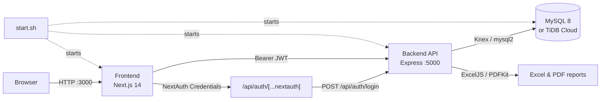

**English** | **[Azərbaycanca](README.az.md)**

# InsurApp — Insurance Management System

DEMO  -
USERNAME - admin@insurance.az
PASSWORD  - password


A fully working **insurance policy, payment, commission, bonus and reporting** management system for insurance agencies. The project consists of two separate applications: an Express + MySQL backend and a Next.js 14 frontend.

> **Who it is for:** insurance companies, agencies and brokers that need a multi-user workflow with admin, agent and subagent roles.

---

## Key features

### Roles and authentication
- Role-based access for **admin, agent and subagent** roles (NextAuth + JWT).
- Admins create, edit and deactivate agents and subagents; every subagent belongs to a parent agent.
- Agent profile: phone, position, branch, FIN, certificate (Ş-V), address, companies and a 0–5 star rating.
- Password reset: the user submits a request → **an admin approves it** → a new password can be set within 60 minutes.

### Insurance policies
- **54 insurance products** in 9 groups (compulsory, voluntary, Ateshgah, Ateshgah Life, Pasha, Pasha Life, Xalq, Meqa, Qala).
- 4 pricing engine categories: **auto (MTPL), casco, property, travel**.
- The premium is calculated automatically when a policy is created, and the payment and commission records are created in the same operation.
- Policy statuses: `active`, `upcoming`, `expired`, `terminated`, `cancelled`.
- Date-range filters, product filter and a detailed policy view.

### Payments and commissions
- A payment record for every policy: `pending`, `paid`, `overdue`, plus payment method and date.
- Admins update payment status and view overall payment statistics.
- Agent commission is calculated as `premium × commission rate`.

### Bonuses and pricing rules
- Admins assign **per-product bonuses** to agents and subagents (bulk assignment supported).
- **Pricing rules**: unconditional or field/operator/value-conditioned extra-percentage rules, with an `effective_from` date.
- Bonus calculation helpers: Ateshgah auto commission table, Pasha bonus table and regional commission.

### Reports
- Admin: overall metrics, breakdown by type and product, agent ranking and drill-down.
- Agent/subagent: only their own sales report.
- **Excel (ExcelJS)** and **PDF (PDFKit)** export, with date filters.
- Charts and visualisation with Recharts.

### Communication
- Admin announcements (audience: everyone / agents / subagents).
- General chat and **direct messages (inbox)**, with file and image attachments (base64).

---

## Tech stack

| Layer | Technologies |
| --- | --- |
| **Frontend** | Next.js 14 (App Router), React 18, TypeScript, Tailwind CSS, Radix UI, shadcn-style components, TanStack Table, Recharts, React Hook Form + Zod |
| **Auth (frontend)** | NextAuth 4 (Credentials provider, JWT session) |
| **Backend** | Node.js, Express 4, Zod validation, JWT, bcryptjs |
| **Database** | MySQL 8.0+ (Knex query builder, `mysql2`), TiDB Cloud compatible (TLS) |
| **Export** | ExcelJS, PDFKit |
| **Orchestration** | `start.sh` — MySQL + backend + frontend |

---

## Architecture



**Flow:** the user signs in through NextAuth → NextAuth calls the backend's `/api/auth/login` endpoint → the backend returns a JWT → the token is stored in the session → every API request is sent with the `Authorization: Bearer <token>` header.

---

## Project structure

```text
InsurApp/
├── start.sh                        # starts MySQL + backend + frontend together
├── System-insurance-back-master/   # Express API
│   ├── migrations/                 # SQL migrations 001–016 + runner
│   ├── src/
│   │   ├── app.js                  # Express app, CORS, routes
│   │   ├── config/db.js            # Knex + MySQL/TiDB connection
│   │   ├── middleware/             # JWT authentication, role checks
│   │   └── modules/
│   │       ├── auth/               # login, profile, agents, password reset
│   │       ├── policies/           # policies + pricing engine
│   │       ├── payments/           # payments
│   │       ├── reports/            # reports + Excel/PDF export
│   │       ├── pricing-rules/      # bonus/pricing rules
│   │       ├── bonuses/            # per-user bonuses
│   │       └── board/              # announcements + chat
│   ├── env.example
│   └── package.json
└── System-insurance-front-master/  # Next.js application
    ├── src/app/
    │   ├── (auth)/login/           # login + password reset
    │   └── (dashboard)/            # dashboard, policies, payments, reports,
    │                               # agents, bonuses, pricing-rules, ...
    ├── src/components/             # UI, sidebar, calculators, board
    ├── src/lib/                    # API client, auth config, product catalog
    ├── env.local.example
    └── package.json
```

---

## Quick start

### Requirements

- **Node.js 18.17+** (20 LTS recommended)
- **npm** (both applications have a `package-lock.json` — use `npm ci` or `npm install`)
- **MySQL 8.0+** or **TiDB Cloud** (with TLS)
- A Linux environment with `sudo` for `start.sh` (it installs MySQL automatically)

### 1. Clone the repository

```bash
git clone https://github.com/Elsen001/InsurApp.git
cd InsurApp
```

### 2. Set up the backend

```bash
cd System-insurance-back-master
cp env.example .env
# edit .env and change DB_PASSWORD and JWT_SECRET
npm install
npm run migrate     # runs all SQL migrations + seed data
npm run dev         # http://localhost:5000
```

Health check: `curl http://localhost:5000/health`

### 3. Set up the frontend

```bash
cd ../System-insurance-front-master
cp env.local.example .env.local
# NEXT_PUBLIC_API_URL must be the origin only: http://localhost:5000
npm install
npm run dev         # http://localhost:3000
```

> **Important:** do not include `/api` in `NEXT_PUBLIC_API_URL`. The API client already appends `/api/...` to every request; with `http://localhost:5000/api` requests would go to `/api/api/...`.

### 4. Start everything with a single command (Linux / Codespaces)

```bash
cp System-insurance-back-master/env.example System-insurance-back-master/.env
bash start.sh
```

What `start.sh` does:

1. Checks MySQL, installs it via `apt` if missing, and creates the `insurance_db` database.
2. Writes the frontend `.env.local` file (with public URLs in Codespaces).
3. Starts the backend (`:5000`) and frontend (`:3000`) processes, logging to `logs/`.
4. In Codespaces, makes ports 3000 and 5000 public.

Logs: `logs/mysql.log`, `logs/backend.log`, `logs/frontend.log`.

### Demo accounts

The migrations create the following accounts via `002_seed_data.sql`:

| Role | Email | Password |
| --- | --- | --- |
| Admin | `admin@insurance.az` | `password` |
| Agent | `ali.hasanov@insurance.az` | `password` |
| Agent | `nigar.aliyeva@insurance.az` | `password` |

> **Note:** although the header of `002_seed_data.sql` says `Admin123!` / `Agent123!`, the bcrypt hash in the file belongs to `password`, and `start.sh` also uses `password`.

---

## Environment variables

### Backend (`System-insurance-back-master/.env`)

| Variable | Required | Description |
| --- | --- | --- |
| `PORT` | No | API port (default `5000`) |
| `DB_HOST` | Yes | MySQL/TiDB host |
| `DB_PORT` | No | Default `3306` (TiDB: `4000`) |
| `DB_USER` | Yes | Database user |
| `DB_PASSWORD` | Yes | Database password |
| `DB_NAME` | No | Default `insurance_db` |
| `DB_SSL` | No | `true` for a remote database |
| `DB_CA` | No | Path to a CA file (system CAs are used if empty) |
| `JWT_SECRET` | Yes | JWT signing key — must be changed in production |
| `JWT_EXPIRES_IN` | No | Default `7d` |
| `NODE_ENV` | No | `development` / `production` |
| `FRONTEND_URL` | No | Frontend origin for CORS |

### Frontend (`System-insurance-front-master/.env.local`)

| Variable | Required | Description |
| --- | --- | --- |
| `NEXT_PUBLIC_API_URL` | Yes | Backend origin, **without `/api`** (e.g. `http://localhost:5000`) |
| `NEXTAUTH_URL` | Yes | Full URL of the frontend (e.g. `http://localhost:3000`) |
| `NEXTAUTH_SECRET` | Yes | Session encryption key — must be changed in production |

---

## API overview

All endpoints are served at `http://localhost:5000`. Protected routes require `Authorization: Bearer <JWT>`.

### Auth — `/api/auth`

| Method | Path | Access | Description |
| --- | --- | --- | --- |
| `POST` | `/login` | Public | Sign in; returns JWT + user data |
| `POST` | `/logout` | Auth | Sign out |
| `GET` | `/me` | Auth | Current user profile |
| `POST` | `/password-reset/request` | Public | Submit a password reset request |
| `POST` | `/password-reset/complete` | Public | Set a new password after approval |
| `GET` | `/password-reset/requests` | Admin | Pending requests |
| `PUT` | `/password-reset/:id` | Admin | Approve / reject |
| `GET` | `/agents` | Admin | Agents + subagents |
| `GET` | `/staff` | Admin | Flat list for bonus assignment |
| `POST` | `/agents` | Admin | Create an agent/subagent |
| `PUT` | `/agents/:id` | Admin | Profile, commission, status, password |

### Policies — `/api/policies`

| Method | Path | Access | Description |
| --- | --- | --- | --- |
| `GET` | `/` | Auth | Agents see their own; admins see all |
| `GET` | `/:id` | Auth | Policy + details + payment + commission |
| `POST` | `/` | Auth | Create a policy (price calculated automatically) |
| `POST` | `/preview-price` | Auth | Preview the price |
| `PUT` | `/:id` | Admin | Status, notes, contact details |
| `DELETE` | `/:id` | Admin | Cancel (soft delete → `cancelled`) |

### Payments — `/api/payments`

| Method | Path | Access | Description |
| --- | --- | --- | --- |
| `GET` | `/` | Auth | Payments (agents see only their own) |
| `GET` | `/stats` | Admin | Statistics by status |
| `PUT` | `/:id/status` | Admin | Status and payment method |

### Reports — `/api/reports`

| Method | Path | Access | Description |
| --- | --- | --- | --- |
| `GET` | `/my` | Auth | Own report |
| `GET` | `/my/export` | Auth | Own report (Excel/PDF) |
| `GET` | `/summary` | Admin | Overall metrics (`from`, `to`) |
| `GET` | `/product-drilldown` | Admin | Drill-down by product |
| `GET` | `/agent/:id` | Admin | Agent report |
| `GET` | `/agent/:id/export` | Admin | Agent report (Excel/PDF) |
| `GET` | `/agents/export` | Admin | Agent list (Excel/PDF) |
| `GET` | `/export` | Admin | Overall report (Excel/PDF) |

### Pricing rules — `/api/pricing-rules`

| Method | Path | Access | Description |
| --- | --- | --- | --- |
| `GET` | `/` | Auth | List rules |
| `POST` | `/` | Admin | Create a rule |
| `PUT` | `/:id` | Admin | Update a rule |
| `DELETE` | `/:id` | Admin | Delete a rule |
| `POST` | `/preview` | Auth | Price preview with rules applied |

### Bonuses — `/api/bonuses`

| Method | Path | Access | Description |
| --- | --- | --- | --- |
| `GET` | `/me` | Auth | Own bonuses |
| `GET` | `/` | Admin | All bonuses |
| `POST` | `/` | Admin | Assign a bonus |
| `PUT` | `/:id` | Admin | Update a bonus |
| `DELETE` | `/:id` | Admin | Delete a bonus |

### Board — `/api/board`

| Method | Path | Access | Description |
| --- | --- | --- | --- |
| `GET` | `/announcements` | Auth | Announcements for the user's audience |
| `POST` | `/announcements` | Admin | Post an announcement |
| `DELETE` | `/announcements/:id` | Admin | Delete an announcement |
| `GET` | `/messages` | Auth | General chat, or direct messages with `?peer=<id>` |
| `POST` | `/messages` | Auth | Message + file attachment |
| `GET` | `/contacts` | Auth | Inbox contacts |

### Other

| Method | Path | Description |
| --- | --- | --- |
| `GET` | `/health` | Server + database health check |

---

## Database

The migrations live in `System-insurance-back-master/migrations/` and are executed in order by `npm run migrate`.

| Table | Purpose |
| --- | --- |
| `users` | Admin / agent / subagent, profile fields, commission rate, rating |
| `policies` | Policies: number, product, premium, commission, dates, status |
| `policy_details` | Type-specific JSON details for each policy |
| `payments` | Payments: amount, status, due date, method |
| `commissions` | Agent commissions |
| `pricing_rules` | Conditional/unconditional bonus rules, effective date |
| `bonuses` | Per-product bonuses for agents/subagents (unique: user + product) |
| `announcements` | Announcements and audience |
| `chat_messages` | General chat, direct messages, file attachments |
| `password_resets` | Password reset requests and admin approvals |

> **Important:** run the migrations **once** on a fresh database. All `ALTER TABLE` statements after `001` are not idempotent, so running `npm run migrate` again on an existing database will fail. To rebuild, drop and recreate the database.

---

## Business logic

### Premium calculation (`pricing.engine.js`)

| Type | Formula |
| --- | --- |
| **Auto (MTPL)** | `150 AZN × age multiplier × engine multiplier`; an extra `+15%` for cars older than 10 years |
| **Casco** | `car value × (1.5%–3%, by age) × driver multiplier`; `+3%` per additional driver |
| **Property** | `max(area × 2.5 AZN/m² × region × building type, value × 0.3% × region)` |
| **Travel** | `days × persons × 3.5 AZN × destination zone × coverage multiplier` |

After pricing rules are applied, the final premium is:

```text
final = base price × (1 + sum of bonus percentages / 100)
commission = final premium × agent commission rate / 100
```

### `type` vs `product`

- `type` — pricing engine category: `auto`, `casco`, `property`, `travel`.
- `product` — a real catalog item (54 products). The `type` is derived automatically from the product name (`deriveType`).

### Policy creation

In a single operation: the policy record + JSON details + a `pending` payment + a `pending` commission. Policy numbers follow the `POL-<year>-<6 digits>` format.

---

## Roles and permissions

| Capability | Admin | Agent | Subagent |
| --- | :---: | :---: | :---: |
| Own dashboard | ✅ | ✅ | ✅ |
| Create / view policies | ✅ (all) | ✅ (own) | ✅ (own) |
| Change payment status | ✅ | — | — |
| Overall reports | ✅ | — | — |
| Own report + export | ✅ | ✅ | ✅ |
| Manage agents/subagents | ✅ | — | — |
| Pricing rules | ✅ | read | read |
| Assign bonuses | ✅ | — | — |
| Own bonuses | ✅ | ✅ | ✅ |
| Post announcements | ✅ | read | read |
| Chat / inbox | ✅ | ✅ | ✅ |
| Approve password resets | ✅ | — | — |

The frontend sidebar is filtered by role, and on the backend every protected route is guarded by the `authenticate` middleware and, where needed, by `requireAdmin`.

---

## Scripts

### Backend (`System-insurance-back-master`)

| Command | Description |
| --- | --- |
| `npm run dev` | Development server with `nodemon` |
| `npm start` | Production server |
| `npm run migrate` | Run all SQL migrations |

### Frontend (`System-insurance-front-master`)

| Command | Description |
| --- | --- |
| `npm run dev` | Next.js development server (`:3000`) |
| `npm run build` | Production build |
| `npm start` | Start the build |
| `npm run lint` | ESLint |

### Root directory

| Command | Description |
| --- | --- |
| `bash start.sh` | Start MySQL + backend + frontend together |

---

## Deployment

### Frontend — Vercel

1. Import the `System-insurance-front-master` directory as a project.
2. Environment variables:
   - `NEXT_PUBLIC_API_URL` → backend origin (e.g. `https://api.example.com`, without `/api`)
   - `NEXTAUTH_URL` → the frontend's production URL
   - `NEXTAUTH_SECRET` → a strong random key
3. Deploy.

### Backend — Node hosting

`src/app.js` is a long-running Node server started with `app.listen()`. On Railway, Render, Fly.io, a VPS or a container:

```bash
npm ci --omit=dev
npm run migrate      # first install only
npm start
```

Deploying to a serverless platform (e.g. Vercel Functions) requires a serverless adapter for Express — this repository does not include one.

### Database — TiDB Cloud

A TiDB example is provided in `env.example`. Set `DB_HOST`, `DB_PORT=4000` and `DB_SSL=true`; `migrations/run.js` supports TLS. For remote databases `pool.min` is automatically `0`.

### Codespaces

`start.sh` detects the Codespaces environment, writes the `*.app.github.dev` URLs into `.env.local` and makes the ports public.

---

## Security notes

- **Change these:** `JWT_SECRET`, `NEXTAUTH_SECRET` and the demo account passwords.
- CORS currently allows every origin for development (`src/app.js`). Restrict it to the frontend origin in production.
- Password resets are two-step: no password changes without an admin approval, and the approval is valid for 60 minutes.
- Chat attachments are sent as base64 with a `12mb` JSON limit; object storage (S3/R2) is recommended for large files.
- Rate limiting, refresh tokens and audit logging are not implemented yet and should be added for production.
- `.env` and `.env.local` are git-ignored; never commit secrets.

---

## Known limitations

- **No automated tests** (neither the backend nor the frontend has a test suite).
- The `npm run seed` script targets `migrations/seed.js`, which does not exist — seed data is loaded by `npm run migrate` through `002_seed_data.sql`.
- The `extra-services` page is still a placeholder.
- Migrations are not idempotent and cannot be re-run.
- The repository has no `LICENSE` file.

### Ideas for next steps

- API tests with Jest/Supertest and E2E tests with Playwright.
- Refresh tokens and a role-aware audit log.
- Move file attachments from the database to object storage.
- One-command setup with Docker Compose.
- Complete the `extra-services` module.

---

## Contributing

1. Fork the repository.
2. Create a branch: `git checkout -b feature/new-feature`
3. Commit your changes: `git commit -m "feat: new feature"`
4. Push the branch: `git push origin feature/new-feature`
5. Open a Pull Request.

Please follow the existing code style and keep UI copy consistent with the Azerbaijani interface.

---

## License

This repository has no license file. Adding a `LICENSE` file (e.g. MIT or a commercial license) is recommended to define usage and distribution terms.

---

**Repository:** [github.com/Elsen001/InsurApp](https://github.com/Elsen001/InsurApp) · **Questions and suggestions:** GitHub Issues
